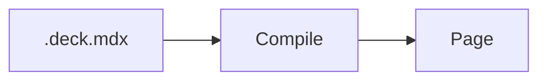
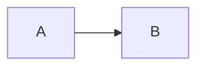
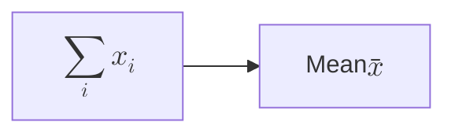
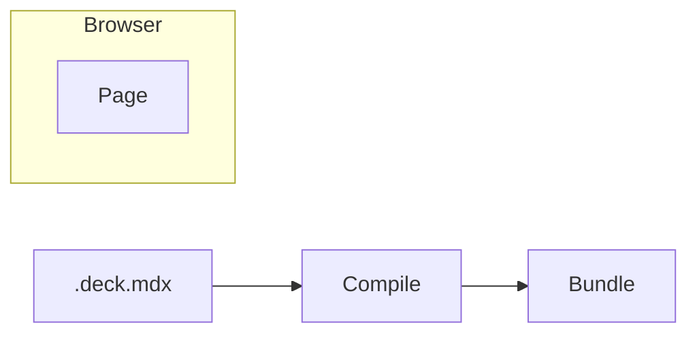
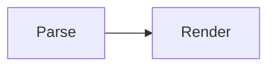

# Diagrams

`@seminar/plugin-pele` turns [Mermaid](https://mermaid.js.org) code blocks
into diagrams with [Pele](https://pele.run). Pele draws the types of diagrams
of Mermaid, like flowcharts, sequence diagrams, and mind maps, and some of its
own, like tree views and Wardley maps.

Diagrams are laid out in the browser, in the font and colors of your theme.
The deck only contains Pele and the types of diagrams that it uses.

## Enabling the plugin

Add `@seminar/plugin-pele` to the dependencies of your project. Then list it
in the plugins in `vite.config.ts`:

```ts
seminar({ plugins: ['@seminar/plugin-pele'] });
```

## Writing diagrams

Write `mermaid` after the opening fence:

````mdx

````

Diagrams that Pele can't parse are shown as code. You get a warning for them,
with the line of the error. Documents of the deck, which clients without
JavaScript read, show the Mermaid source of diagrams.

Diagrams are shown with the previous step, like images. The first line of the
block takes the attributes of `:step` after `mermaid`, e.g., to show the
diagram in a step of its own, or to give it a name that
[callouts](../elements/callouts.md) can point at:

````mdx


::callout[The pipeline]{for=pipeline}
````

## Size

Diagrams take the width available to them, e.g., of their column. Wider
diagrams are laid out again to fit it, e.g., flowcharts from top to bottom,
and narrower ones keep their size. Their text is three quarters of the size of
the text around them.

The first line of the block also takes the size of the diagram:

- `width` sets its width, in logical slide pixels or any CSS length. Diagrams
  are laid out in it even if it's more than available, and shown smaller to
  fit, like images.
- `zoom` scales it, e.g., `zoom=1.5` for larger text. Zoomed diagrams are laid
  out to fit their width before zooming.
- `fontSize` sets the size of its text before zooming, in logical slide pixels
  or any CSS length, e.g., `0.6em` of the text around it. Unlike zooming, it
  keeps the space between nodes, so smaller text squeezes in more.

````mdx

````

Set the size of the text of every diagram in the theme, see
[Styling diagrams](#styling-diagrams).

## Math in labels

Write TeX between `$$` in labels, like in Mermaid:

````mdx

````

Formulas are typeset with MathJax when the deck is compiled, like
[math](../mathjax/index.md) on slides, with the font and the macros of the
`math` options of the deck. They don't need `@seminar/plugin-mathjax` to be
enabled, which would also make dollar signs in the text of slides math.

## Revealing items in steps

The items of diagrams can be shown in steps of their own. The layout of the
diagram stays the same, with room for the items that aren't shown yet. Write
`%% step` before a statement to show what it's about in a new step:

````mdx

````

What a statement is about depends on the type of the diagram:

| Diagram                      | A statement is about                                                                                          |
| ---------------------------- | ------------------------------------------------------------------------------------------------------------- |
| Flowchart, swimlane          | its edges, the nodes that it gives a label or a shape, like `bundle["Bundle"]`, or the subgraph that it opens |
| Agent workflow               | the same as in flowcharts, with `flow` for `subgraph`                                                         |
| State                        | its transitions, the states that it declares, like `A: waiting`, or the composite state that it opens         |
| Sequence                     | its messages or notes, the participant that it declares, or the block that it opens, like `loop`              |
| Class                        | its relations, its note, the class that it declares with `class`, or the namespace that it opens              |
| Entity relationship          | its relationships, the entity that it declares, like `CUSTOMER {`, or the subgraph that it opens              |
| Requirement                  | the requirement or element that it declares, or its relation                                                  |
| Architecture                 | the service, junction, or group that it declares, or its edge                                                 |
| C4                           | the element or relation that it declares, or the boundary that it opens                                       |
| Block                        | the blocks that it places, the composite block that it opens, or its edges                                    |
| Use case                     | its relationships, the actors and use cases that it declares, or the system boundary that it opens            |
| Mind map, treemap, tree view | its node, file, or directory                                                                                  |
| Kanban                       | its column or card                                                                                            |
| Timeline, journey, Gantt     | its period or task, or the section that it opens                                                              |
| Pie, quadrant, packet, Venn  | its slice, point, field, set, or union                                                                        |
| Radar, XY chart              | its curves, or its series, `bar` or `line`, named `series-1`, `series-2`, and so on                           |
| Sankey                       | its link, and the nodes that it mentions first                                                                |
| Git graph                    | the commit that it makes, like with `commit` or `merge`, or the branch that it creates                        |
| Ishikawa                     | its category, but not its causes                                                                              |
| Cynefin                      | the domain that it opens, its item, or its transition                                                         |
| Wardley                      | the anchor or component that it declares, with its evolution, or its link                                     |
| Event modeling               | its time frame                                                                                                |
| Railroad                     | the rule that it starts                                                                                       |

Items that a statement only names, like `compile` in
`compile --> bundle["Bundle"]`, keep their own step. You get a warning for a
step whose statement is about nothing that can be shown, like a cause in an
Ishikawa diagram.

Steps take the attributes of `:step` after `step`, e.g., `%% step only` or
`%% step group=emit` to show the items with other content of the slide. List
the items in brackets to step them wherever they are, with `A->B` for the
edges from `A` to `B`:

```text
%% step[compile, source->compile] only
```

Items can also take their step in their shape data, where the type of the
diagram has it: nodes and edges with ids in flowcharts, like
`bundle["Bundle"]@{ step }` or `e1@{ step: "group=emit" }`, participants in
sequence diagrams, and cards in kanban boards.

Items are shown with the items that they are in, like subgraphs, composite
states, blocks, namespaces, groups, boundaries, sections, branches, or the
nodes that they are indented under, unless they have steps of their own,
which come in the step of the item around them. An edge without a step of its
own is shown with the later of its ends, and the edges of mind maps with the
nodes that they lead to. You get a warning for an edge that is shown before
both of its ends.

## Pointing at items

The items of a named diagram, like its nodes, clusters, and edges, are named
after it, with a dot and their id in Mermaid, so callouts can point at them:

````mdx


::callout[Turns MDX into a tree]{for=pipeline.parse}
::callout[Runs in the browser]{for=pipeline.e1}
````

Give edges an id, like `e1@` in `A e1@--> B`, to point at them. Items without
an id, like the nodes of mind maps, are named by their text, and if two items
have the same name, it refers to the first of them. Give them ids, like
`ex1[Examples]`. The references to rules in railroad diagrams aren't named,
because the rules have their names.

## Styling diagrams

Diagrams are `Diagram` components. Their colors come from the palette of the
theme, as the CSS custom properties of Pele, like `--pele-accent` and
`--pele-surface`. Style them as `SeminarDiagram` in the MUI theme of your
slides, e.g., to change the size of their text or their colors:

```ts
createSlideTheme({
  components: {
    SeminarDiagram: {
      styleOverrides: {
        root: { fontSize: '0.6em', '--pele-accent': '#b3261e' },
      },
    },
  },
});
```

See [Theming](https://pele.run/theming) for the custom properties of Pele.

Items in steps that aren't shown have the classes `SeminarDiagram-hidden`,
`SeminarDiagram-dimmed`, and so on, which you can style in the `root` of
`SeminarDiagram`, too.
