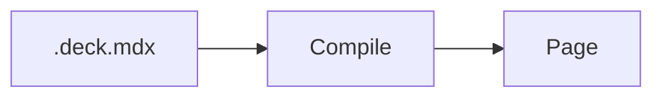
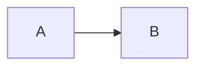

# Diagrams

`@seminar/plugin-pele` turns [Mermaid](https://mermaid.js.org) code blocks
into diagrams with [Pele](https://pele.run). Pele supports the types of
diagrams of Mermaid, like flowcharts, sequence diagrams, state diagrams, and
mind maps.

Diagrams are laid out in the browser, in the font and colors of your theme.
The deck only contains Pele and the types of diagrams that it uses.

## Enabling the plugin

Add `@seminar/plugin-pele` to the dependencies of your project. Then list it
in the plugins in `vite.config.ts`:

```ts
seminar({ plugins: ['@seminar/plugin-pele'] });
```

## Writing diagrams

Write `mermaid` after the opening fence:

````mdx

````

Diagrams that Pele can't parse are shown as code. You get a warning for them,
with the line of the error.

Diagrams are shown with the previous step, like images. The first line of
the block takes the attributes of `:step` after `mermaid`, e.g., to show the
diagram in a step of its own, or to give it a name that
[callouts](../elements/callouts.md) can point at:

````mdx


::callout[The pipeline]{for=pipeline}
````

## Styling diagrams

Diagrams are `Diagram` components. Their text is three quarters of the size
of the text of the slide, in the same font. Their colors come from the palette
of the theme, as the CSS custom properties of Pele, like `--pele-accent` and
`--pele-surface`.

Style them as `SeminarDiagram` in the MUI theme of your slides, e.g., to
change the size of the text or the colors:

```ts
createSlideTheme({
  components: {
    SeminarDiagram: {
      styleOverrides: {
        root: { fontSize: '0.6em', '--pele-accent': '#b3261e' },
      },
    },
  },
});
```

See [Theming](https://pele.run/theming) for the custom properties of Pele.

Documents of the deck, which clients without JavaScript read, show the
Mermaid source of diagrams.
