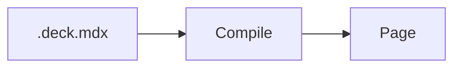
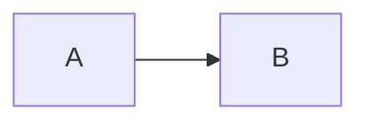
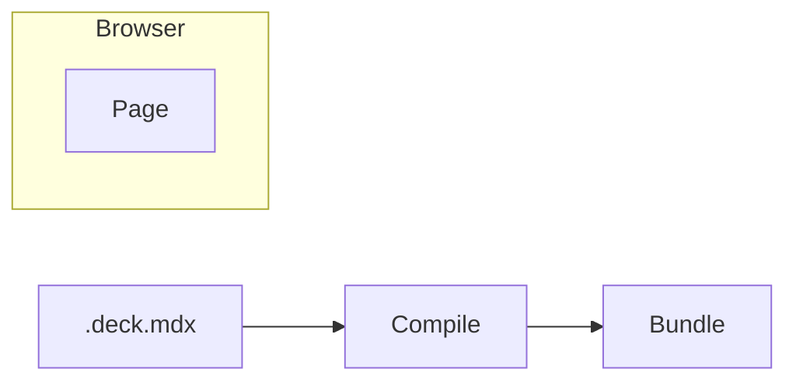
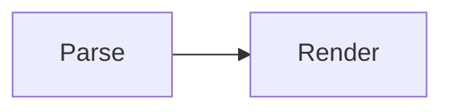

# Diagrams

`@seminar/plugin-pele` turns [Mermaid](https://mermaid.js.org) code blocks
into diagrams with [Pele](https://pele.run). Pele supports the types of
diagrams of Mermaid, like flowcharts, sequence diagrams, state diagrams, and
mind maps.

Diagrams are laid out in the browser, in the font and colors of your theme.
The deck only contains Pele and the types of diagrams that it uses.

## Enabling the plugin

Add `@seminar/plugin-pele` to the dependencies of your project. Then list it
in the plugins in `vite.config.ts`:

```ts
seminar({ plugins: ['@seminar/plugin-pele'] });
```

## Writing diagrams

Write `mermaid` after the opening fence:

````mdx

````

Diagrams that Pele can't parse are shown as code. You get a warning for them,
with the line of the error.

Diagrams are shown with the previous step, like images. The first line of
the block takes the attributes of `:step` after `mermaid`, e.g., to show the
diagram in a step of its own, which the steps of its items come in, or to give
it a name that
[callouts](../elements/callouts.md) can point at:

````mdx


::callout[The pipeline]{for=pipeline}
````

## Revealing items in steps

Nodes, subgraphs, and edges of flowcharts can be shown in steps of their own.
The layout of the diagram stays the same, with room for the items that aren't
shown yet. Write `%% step` before a statement to show what it's about in a new
step:

````mdx

````

A statement is about its edges, the nodes that it gives a label or a shape,
like `bundle["Bundle"]`, and the subgraph that it opens. Nodes that it only
names, like `compile` in `compile --> bundle["Bundle"]`, keep their own step.

Steps take the attributes of `:step` after `step`, e.g., `%% step only` or
`%% step group=emit` to show the items with other content of the slide.
List the items in brackets to step them wherever they are, with `A->B` for the
edges from `A` to `B`:

```text
%% step[compile, source->compile] only
```

In flowcharts, a node or an edge with an id can also take its step in its
shape data: `bundle["Bundle"]@{ step }` or `e1@{ step: "group=emit" }`.

Items in a subgraph are shown with it, unless they have steps of their own,
which come in the step of the subgraph. An edge without a step of its own is
shown with the later of its ends. You get a warning for an edge that is shown
before both of its ends.

Style the appearances of the items as `SeminarDiagram-hidden`,
`SeminarDiagram-dimmed`, and so on, in the `root` of `SeminarDiagram`.

## Pointing at nodes

The nodes, clusters, and edges of a named diagram are named after it, with a
dot and their id in Mermaid, so callouts can point at them:

````mdx


::callout[Turns MDX into a tree]{for=pipeline.parse}
::callout[Runs in the browser]{for=pipeline.e1}
````

Give edges an id, like `e1@` in `A e1@--> B`, to point at them. Nodes of mind
maps without an id are named by their text, and if two items have the same id,
the name refers to the first of them. Give them ids, like `ex1[Examples]`.

## Styling diagrams

Diagrams are `Diagram` components. Their text is three quarters of the size
of the text of the slide, in the same font. Their colors come from the palette
of the theme, as the CSS custom properties of Pele, like `--pele-accent` and
`--pele-surface`.

Style them as `SeminarDiagram` in the MUI theme of your slides, e.g., to
change the size of the text or the colors:

```ts
createSlideTheme({
  components: {
    SeminarDiagram: {
      styleOverrides: {
        root: { fontSize: '0.6em', '--pele-accent': '#b3261e' },
      },
    },
  },
});
```

See [Theming](https://pele.run/theming) for the custom properties of Pele.

Documents of the deck, which clients without JavaScript read, show the
Mermaid source of diagrams.
